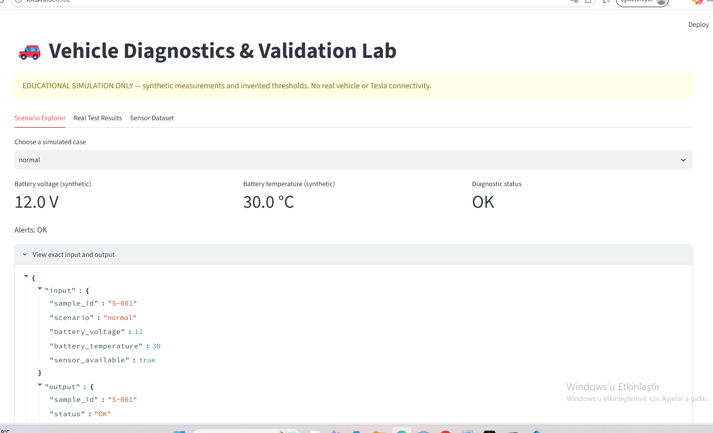
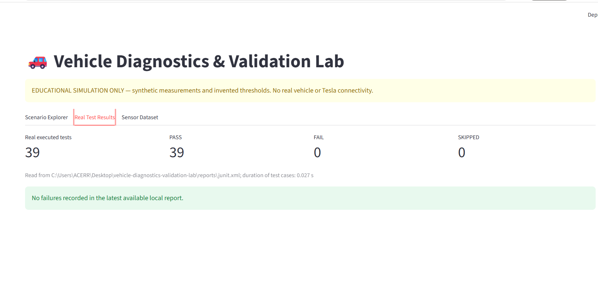
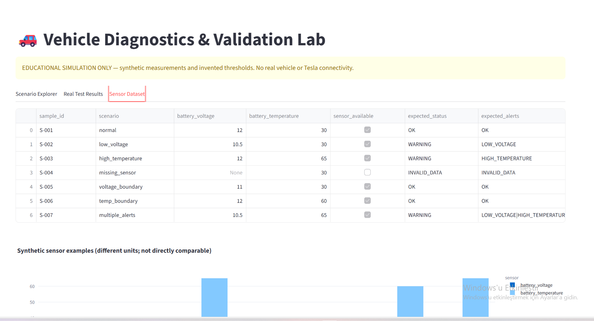
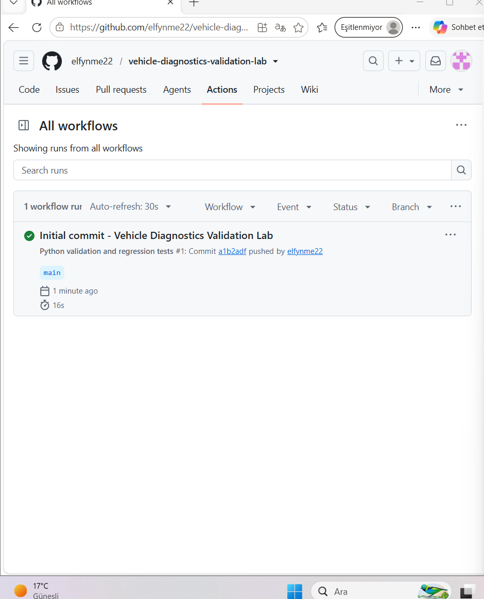

# Vehicle Diagnostics & Validation Lab

**A small code change can break a diagnostic rule. Automated tests should catch it.**

[](https://github.com/elfynme22/vehicle-diagnostics-validation-lab/actions/workflows/tests.yml)


A Python-based educational vehicle diagnostics simulation focused on **software validation, automated testing, and regression detection**. I used synthetic battery voltage and temperature readings to build predictable warning rules, test boundary cases, and demonstrate how a one-character code change can break existing behavior.

**At a glance:** 39 automated tests passed locally · a deliberate boundary regression was detected (38 passed, 1 failed) and fixed (39 passed) · GitHub Actions workflow succeeded.

> **Scope:** Independent educational project. No real vehicle connection, manufacturer diagnostics, Tesla affiliation, or production-safety claims. All sensor samples and thresholds are invented.

## See the project

### Diagnostic scenario explorer

Select a simulated scenario to view battery readings, input data, and diagnostic alerts.



### Automated test results

The dashboard reads **real pytest JUnit XML output** generated by a test run. It does not invent pass/fail counts.



### Example sensor data

The dataset contains normal, low-voltage, high-temperature, missing-sensor, boundary, and simultaneous-alert examples. The values are illustrative, not actual vehicle readings.



## The regression I tested

My most useful experiment was intentionally changing a voltage comparison:

```diff
- voltage < LOW_VOLTAGE_LIMIT
+ voltage <= LOW_VOLTAGE_LIMIT
```

The expected rule is **11.0 V → OK**; low voltage means **strictly below 11.0 V**. Including the boundary by mistake made an existing pytest case fail:

```text
FAILED tests/test_diagnostics.py::test_voltage_boundary[11.0-OK]
AssertionError: assert 'LOW_VOLTAGE' == 'OK'
1 failed, 38 passed
```

I restored `<`, reran the suite, and saw **39 passed**. This demonstrates regression testing: reusing existing tests after a change to catch broken behavior. The incorrect code was not retained.

## Automated validation with GitHub Actions

Every push or pull request runs the core pytest suite in a clean GitHub-hosted Python environment. The workflow also uploads a JUnit test report.

[View the CI workflow and runs →](https://github.com/elfynme22/vehicle-diagnostics-validation-lab/actions/workflows/tests.yml)



## How it works

```text
Synthetic sensor scenario
        ↓
Input validation (missing or malformed data?)
        ↓
Rule-based diagnostics (voltage / temperature)
        ↓
Status and alerts → CLI or Streamlit dashboard

pytest test cases → JUnit XML report → Dashboard test metrics
GitHub push / pull request → GitHub Actions → pytest
```

| Scenario | Battery voltage | Temperature | Expected alert/status |
|---|---:|---:|---|
| `normal` | 12.0 V | 30 °C | OK |
| `low_voltage` | 10.5 V | 30 °C | LOW_VOLTAGE |
| `high_temperature` | 12.0 V | 65 °C | HIGH_TEMPERATURE |
| `missing_sensor` | unavailable | 30 °C | INVALID_DATA |

The illustrative rules use `< 11.0 V` for low voltage and `> 60.0 °C` for high temperature. Multiple warnings can be reported together; invalid input is handled explicitly. See the [engineering decisions](docs/decisions.md) and [test plan](docs/test-plan.md).

## Tech stack

| Tool | Role |
|---|---|
| Python | Simulator, input validation, diagnostic rules, CLI |
| pytest | Unit, boundary, invalid-input and data-driven tests |
| Streamlit + Plotly | Scenario explorer and test report visualization |
| Git / GitHub Actions | Version tracking and automated test runs |
| pandas | CSV scenario examples |
| scikit-learn (optional) | Separate synthetic anomaly-detection experiment |

## Run it locally

**Requirements:** Python 3.12 recommended; Windows 11 / VS Code commands below. The first installation needs an internet connection.

```powershell
py -m venv .venv
.\.venv\Scripts\Activate.ps1
python -m pip install -e ".[all]"
```

If PowerShell blocks activation, use `.\.venv\Scripts\python.exe` instead of `python` in the following commands.

**Run the simulated diagnostic CLI:**

```powershell
vehicle-diagnostics --scenario normal
vehicle-diagnostics --scenario low_voltage
vehicle-diagnostics --scenario high_temperature
vehicle-diagnostics --scenario missing_sensor
```

**Run the tests and generate the dashboard's report:**

```powershell
New-Item -ItemType Directory -Force reports
python -m pytest -v --junitxml=reports/junit.xml
```

**Launch the dashboard:**

```powershell
python -m streamlit run dashboard/app.py
```

Open the local URL Streamlit prints (often `http://localhost:8501`). This is a **local** application; it is not yet a publicly hosted demo. In *Real Test Results*, the dashboard reads the local `reports/junit.xml` file.

**Optional simulated ML experiment:**

```powershell
python ml/anomaly_detection.py
```

The optional IsolationForest experiment uses generated data and is **not** a validated real-world fault detector. For core tests only, `python -m pip install -e ".[test]"` is sufficient.

## Repository guide

```text
src/vehicle_diagnostics/    simulator, validation, diagnostics, reporting, CLI
 tests/                     automated pytest suite
 data/                      labeled synthetic CSV examples
 dashboard/app.py           Streamlit visualization
 ml/anomaly_detection.py    optional synthetic ML experiment
 docs/                      test plan, design decisions, learning log, screenshots
 .github/workflows/         tests on push and pull request
 pyproject.toml             project and dependency configuration
```

## Limitations and next steps

This is a **repeatable software-testing exercise**, not a real car diagnostic system. It has no OBD/CAN access, no live vehicle sensor stream, no manufacturer-specific thresholds or service actions. Passing synthetic tests does not demonstrate real vehicle safety. The CI workflow tests the Python core; it does not automatically validate Streamlit or ML performance.

Future improvements could include a hosted read-only demo, additional integration tests, richer failure reports and independently evaluated sensor datasets.

**Technical documentation:** [Test plan](docs/test-plan.md) · [Engineering decisions](docs/decisions.md) · [Learning log](docs/learning-log.md)
